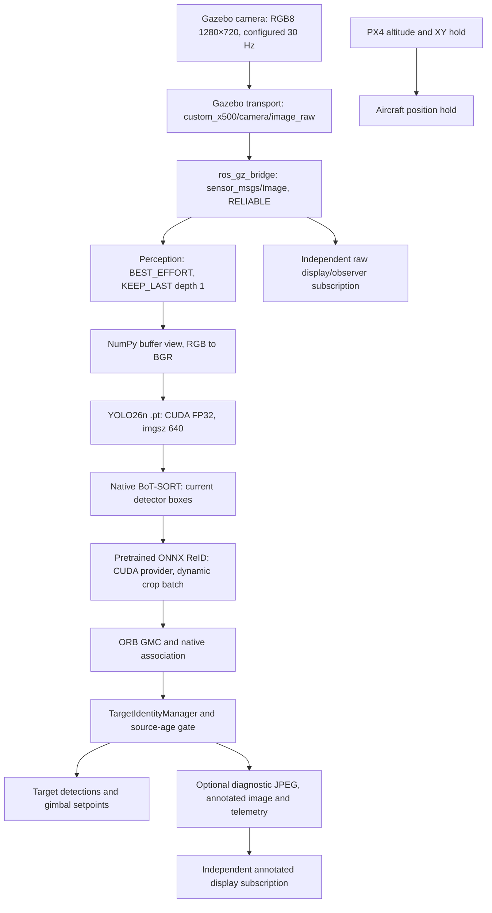

# Perception and video pipeline audit — measurements 2026-10-15/16

**PERFORMANCE AUDIT: PASS.** The controlled fixed-input run improves both processing rate and frame age; the selected settings also completed a full simulation with guard replay and a clean landing. Target identity continuity remains FAIL independently of this performance result. No UAV body-following exists.

## Scope and provenance

Ponytail 5.2.0 was installed using the official `DietrichGebert/ponytail` marketplace and plugin commands. The standalone official skill was installed with the supplied skill installer, pinned to commit `84740e3d344b69b4a133201fa519eb37a62a2b2a`; its Git blob is `b76922f76ec6f4db532203c55d710b749fa1f6af`. The CLI `/hooks` screen confirmed trust and active lifecycle hooks. An existing Node installation was exposed on the existing user PATH; no Node package was installed. This running desktop conversation uses the read upstream skill directly; desktop hook reload after app restart was not tested.

Evidence is in `evaluation/results/runs/perception_video_audit_20261015T080217Z/`. The pre-change manifest and saved source image define the controlled comparison. The retained 1 ms executor yield belongs to the baseline. Model weights, precision, thresholds, tracker algorithm, guard policy, controller and scenarios are fixed.

## Actual data path

The current perception output reaches the gimbal only. PX4 body control is an independent position/altitude hold loop, not a consumer of target detections. There is no perception-to-PX4 body-following path to benchmark. In the test runner autonomous gimbal tracking is disabled to preserve its prescribed camera-yaw scenarios; unit/ROS integration tests cover the command path.

YOLO, BoT-SORT, ReID, the guard, publishing and annotation run synchronously in one image callback. Images, reset and watchdog/statistics share a mutually exclusive callback group; `/clock` uses the default group. A two-worker executor dispatches with the existing 1 ms yield. A Python processing worker does not hold an application FIFO of camera frames. The DDS image history is bounded to one unread sample. The existing `is_processing` drop counter is generally zero because callback serialization prevents reentry; it is not a count of source frames skipped by DDS.

Source time comes from Gazebo `/world/<world>/clock`, bridged to ROS `/clock`; image headers use that simulation epoch. Age is checked at ingress and after detector/tracker processing with the existing 0.75 s budget. Expired outputs do not enroll, teach identity or command a target. Durations use monotonic wall time. Wall/RMW timestamps and simulation timestamps are recorded separately and are never directly subtracted.

## Copies and runtime details

- No `cv_bridge` occurs in this node. `image_to_bgr` views the ROS byte buffer with NumPy, honors `step`, then converts RGB8 to BGR. The BGR input branch currently makes its own copy. Mono inputs convert to BGR.
- Native Ultralytics letterboxes the 720×1280 camera image to 384×640 for `imgsz=640` with rectangular padding. The installed predictor already avoids `np.stack` for one image. It transfers uint8 input to CUDA, permutes/flips channels on device, creates contiguous NCHW storage, converts to FP32 and normalizes. No duplicate preprocessing is added by this task.
- Detector boxes cross to CPU/NumPy for the native tracker. These small measurements must remain available to BoT-SORT and the guard. Auxiliary HSV descriptors are computed from current CPU torso crops.
- Native BoT-SORT initializes high/low-confidence detection groups, calls the configured encoder for nonempty groups, applies ORB GMC and runs association. ReID can therefore have multiple calls per frame; timing and crop counts are accumulated per update. The pretrained ONNX model has dynamic batch/height/width and 512-dimensional outputs. The native encoder batches valid crops within each group; it does not make a separate inference for every person.
- The native encoder resizes/normalizes crops on CPU and moves the batch to CUDA. The installed dynamic ONNX backend then calls `im.cpu().numpy()` before `session.run`; it returns CPU arrays which `AutoBackend` moves to CUDA before the encoder copies embeddings back to CPU. These repeated transfers are an identified candidate, not a claim that a replacement is accepted.
- ORB operates on its native downscaled grayscale frame and excludes detection boxes for estimation. Its algorithm and determinant validation remain fixed. Adapter residual time is reported separately from nested ReID/GMC; nested durations must not be added twice.
- Target output is published before diagnostic JPEG creation and annotation. Those display/evaluation operations still occupy the image callback and can reduce processing throughput. Annotated output remains RELIABLE, KEEP_LAST depth 10. Source header stamps are preserved.
- The current runtime uses raw `sensor_msgs/Image`. No RTSP/GStreamer input, `CompressedImage`, image-transport compression or dashboard-to-AI decode path exists in the production source. OpenCV video capture/writing appears in offline evaluation, not as the live AI source. Compression, composition and a new video server are not justified by this local raw-image audit.

## Measurement definitions

`/yolo/performance` is opt-in and off by default. It records source stamp, callback receipt (wall/monotonic/source clock), RMW publish/receive wall stamps, processing start, YOLO completion and native preprocess/inference/postprocess durations, ReID completion/crop/preprocess/backend timings, GMC completion, tracker completion, guard decision, output publish and completion of the whole callback. Existing five-value `/yolo/telemetry` is unchanged.

`profile_perception_pipeline.py` observes native Gazebo source frames independently, raw ROS delivery, the node's own callback/completion events, annotated delivery, resources and optionally actual Qt paint events. A source stamp is counted as painted only when a new image is drawn; delivery counts are not called rendered FPS. This is an instrumented Qt viewer using installed Qt, not a measurement of rqt/RViz compositor presentation. No claim about Windows physical display refresh is made.

The controlled ROS test uses the same saved raw camera image (frame 400, three people), RGB8 at 30 Hz, separate 250 Hz `/clock` publication and the actual production node in ROS domain 84. Source capture wall/monotonic stamps are joined by exact source key, so capture-to-DDS and capture-to-output wall ages can be measured without converting simulation time. It isolates transport/inference choices; complete Gazebo traces check behavior when faster processing changes the selected input sequence.

The first live probe had no Gazebo publisher and is excluded. One subsequent startup was excluded because old SITL processes still held the port; it did not produce valid runtime evidence. The first complete baseline's RMW metadata fields were zero because the instrumentation incorrectly treated rclpy's dictionary as an object. Its source-clock ages and other durations are valid; its middleware/queue latency is unavailable. The dictionary access was corrected and a regression was added. Missing timestamps are never treated as zero latency.

## Earlier eager Gazebo captures

The eager/default-transport baseline (`tracking_3_people_20261015T081427Z`) completes and lands. Its profiler starts late, at source 77.848 s; do not compare its full window directly with the selected run. The eager/large-buffer transport run (`tracking_3_people_20261015T081935Z`) also completes and lands. The matched controlled inputs below provide the causal before/after comparison; full-run comparisons are context because their source-time windows differ.

| Complete run, observed wall rates | Default transport | Large transport |
|---|---:|---:|
| Native Gazebo source FPS | 29.07 | 28.85 |
| Independent raw ROS delivery FPS | 9.40 | 28.60 |
| Actual AI processing FPS | 5.57 | 6.24 |
| Annotated delivery FPS, no GUI | 2.58 | 6.23 |
| Unique frames painted (display off) | 0 | 0 |
| Decision age p95, source ms | 360 | 296 |

These complete-run windows differ and are contextual observations, not an isolated causal FPS estimate. Faster raw transport alone does not remove inference/ReID time. A late ReID stall in the transport run exceeds the age budget and is rejected; this is processing delay, not evidence of an unbounded camera backlog.

## Controlled before/after benchmark

The production node received the same saved 1280×720 RGB frame (three people) at 30 Hz in every case; only the listed runtime option changed. The primary baseline is the valid stock Fast DDS profile repeat. Values are wall-clock milliseconds except source-clock age.

| Stage | Stock p50 / p95 | Selected p50 / p95 | Change |
|---|---:|---:|---|
| Camera source FPS | 29.97 | 30.01 | unchanged |
| Source → ROS raw-image observer FPS | 19.00 | 29.98 | transport profile restores near-source delivery |
| Actual perception callbacks / completed AI FPS | 8.49 | **11.34** | +33.5% |
| Source → DDS receive | 3.11 / 6.47 | 2.60 / 5.90 | no transport penalty |
| Queue wait to callback | 27.27 / 67.35 | 14.95 / 31.92 | lower waiting time |
| Frame age at callback | 25.37 / 66.28 | 13.69 / 30.73 | fresher input |
| YOLO preprocess | 3.59 / 11.57 | 3.35 / 7.06 | similar |
| YOLO inference | 36.68 / 70.41 | **15.02 / 18.26** | CUDA Graph |
| YOLO postprocess | 5.14 / 9.44 | 7.16 / 14.40 | variable; unchanged code |
| YOLO total | 48.07 / 89.00 | 26.80 / 38.21 | lower |
| BoT-SORT update (includes nested ReID/GMC) | 33.05 / 48.06 | 32.43 / 45.48 | similar |
| ReID (nested in tracker; not additive) | 25.98 / 31.36 | 24.30 / 31.36 | similar |
| ORB GMC (nested in tracker; not additive) | 3.00 / 4.52 | 3.23 / 4.47 | similar |
| Guard decision | 1.52 / 3.49 | 1.47 / 2.86 | negligible cost |
| Complete image callback | 105.10 / 167.47 | **82.64 / 109.60** | p95 −34.6% |
| Frame age at guard decision | 116.52 / 186.28 | **80.20 / 112.22** | p95 −39.8% |

Controlled maxima (ms) were: source→DDS **12.11→12.89**; queue wait **114.61→38.75**; receive age **109.90→33.83**; YOLO preprocess **40.97→18.04**, inference **153.74→26.66**, postprocess **105.56→110.53**, total **166.61→132.31**; tracker **106.89→131.24**; nested ReID **100.13→105.81**; nested GMC **51.08→103.03**; guard **40.89→19.39**; full callback **305.46→195.33**; decision age **296.60→181.76**. These maxima include occasional scheduling and runtime outliers; p95 is more representative.

The same-input stock repeat measured 9.13 FPS and 162.52 ms decision-age p95, so the baseline range was 8.49–9.13 FPS and 162.52–186.28 ms. The valid stock repeat processed 278 of 981 source frames in-window (703 did not complete); the selected run processed 375 of 992 (617 did not complete) during a 33.06-second interval. The depth-one best-effort subscription replaces unread images rather than queuing a seconds-old FIFO. These are source frames not processed in-window, not middleware drop counters.

| Runtime metric | Stock repeat | Selected combined | Evidence |
|---|---:|---:|---|
| GPU utilization, median | 28% | 32.5% | same host, sampled at 1 Hz |
| Perception process CPU, median | 490% | 570% | 100% means one logical core |
| Perception RSS, median | 1.95 GB | 2.02 GB | process resident memory |
| GPU memory, median | 485 MiB | 485 MiB | YOLO + ReID |
| Unique frames painted, display off | 0 | 0 | headless run |

The full simulation with both selected settings covered source time 53.364–236.184 s after ten warm-up completions. It measured **29.24 source FPS, 29.22 raw ROS receive FPS and 7.96 actual AI completions/s**; 1,510/1,510 profiled frames used CUDA Graph. Decision-age p50/p95/max was **116/260/448 ms**; complete callback p50/p95/max was **101.6/247.0/435.0 ms**. Source stamps were 4,031/5,541 unprocessed inside the measured interval (72.8%), while receipt age p95 stayed 64 ms and queue-wait p95 was 37.5 ms. That is bounded latest-frame dropping, not a growing backlog.

The full-run stage timings were YOLO **27.63/41.80/72.96 ms p50/p95/max** (inference 9.56/21.21/36.88; preprocess 3.76/8.30/17.74; postprocess 9.49/18.76/41.03), tracker **38.14/178.24/372.86 ms**, nested ReID **26.10/166.17/356.09 ms**, nested GMC **3.14/6.47/27.27 ms**, guard **0.75/2.87/17.88 ms**, source→DDS **2.56/6.90/20.79 ms** and post-output diagnostics/annotation **27.65/43.87/136.76 ms**. The long tail is mainly tracking/ReID. Process CPU was **271/331/374% p50/p95/max**, GPU utilization **34/41/55%**, RSS **2.06/2.07/2.08 GB**, GPU memory **717/932/1,009 MiB**. The callback is serialized; the substantial CPU use and low GPU utilization leave runtime transfer/preprocessing work to investigate before changing either model.

The earlier default-transport complete run measured 5.57 AI FPS and 360 ms decision-age p95. The transport-only complete run measured 6.24 FPS and 296 ms p95. The selected full run measured 7.96 FPS and 260 ms p95. These complete-run windows and source sequences differ; use the controlled table above for causal comparison. The profiler window excludes the first ten completed callbacks; the independent full-run observer saw 1,438 frames at 7.03 FPS across its longer capture.

## Display and Gazebo GUI

The off-display controlled selected run delivered 11.34 annotated images/s and painted zero frames. In the separate Qt-viewer run, the same fixed source delivered 10.09 annotated images/s and the viewer painted **10.12 unique frames/s**. Its processing rate was 10.12 FPS and decision-age p95 was 118.1 ms versus 11.34 FPS and 112.2 ms with display off. These are short sequential runs, so the small difference is suggestive rather than a precise causal estimate. This viewer measures actual Qt paint events, not Windows compositor/v-sync or rqt/RViz.

Gazebo GUI was enabled during the full simulation from source time 123.256 to 141.112 s, inside the same repeated-crossing stage. Adjacent headless / GUI / headless windows measured AI **7.12 / 7.28 / 7.13 FPS**, decision-age p95 **265 / 273 / 260 ms**, complete-callback p95 **250 / 258 / 245 ms**, and approximate source FPS **28.83 / 28.31 / 28.88**. The simulator's real-time factor dipped from about 0.96 to 0.94 while GUI rendered, then returned to 0.96. The GUI process averaged about 72% of one core and 566 MiB RSS during its 19 samples. This A/B/A is observational, with moving actors and short windows: it shows a small simulation-rate cost but no measurable AI-throughput change in this sample.

## Tried options and retained settings

- **Retained:** larger Fast DDS image-message transport capacity. It raised raw ROS image delivery from about 19 to 30 FPS and reduced source age before processing. The bridge remains RELIABLE/KEEP_LAST depth 10; the production perception reader remains BEST_EFFORT/depth 1. The bridge parameter query confirmed depth 10 and `keep_last`; endpoint discovery reported depth as unknown.
- **Retained:** optional fixed-shape CUDA Graph around the existing YOLO forward pass, default on for CUDA. It changes neither weights nor precision. A 100-frame real-video eager/graph comparison was bit-identical for box coordinates, confidence and class; changing-image/model tests passed, and the full simulation reports graph active on every measured frame.
- **Rejected:** disabling ONNX Runtime spinning; it reduced throughput and worsened frame age. Forcing one PyTorch CPU thread and increasing the executor yield from 1 to 5 ms supplied no repeatable benefit; keep the existing executor setting.
- **Not retained:** an ROI-only HUD shading micro-optimization saved about 0.67 ms in a pixel-identical microbenchmark, too little to justify another code path. The CUDA ONNX I/O-binding prototype was not validated in a controlled run. Do not count it as a gain.
- **Unchanged:** model, precision, image geometry, tracker/GMC, ReID model, guard, gimbal/PX4 behavior, test world and actor paths. No new runtime dependency or video framework was added.

## Tracking replay and acceptance

The full selected simulation completed through 236 s, landed (`landed=true`) and shut down cleanly (`observer_exit=0`). The 1,518-frame guard trace replayed through the saved pre-run guard and current guard with **zero output mismatches, zero wrong or unknown accepted identities, and 22 recoveries**. The selected full runtime still accepted the enrolled target on only 154 of 1,438 observer frames; identity continuity remains **FAIL** under existing project acceptance. This task did not change guard policy, and the performance result is not a tracking-continuity pass.

The profiler and guard use different ROS observation windows, so their frame totals need not match. The full run enabled guard diagnostics to capture replay inputs; diagnostic JPEG/annotation work is part of callback completion and can make this runtime slower than the default debug-off deployment.

## Direct answers and next work

1. **Largest bottleneck:** serialized callback cost, especially BoT-SORT/ReID tail latency; tracker p95 is 178 ms and ReID p95 is 166 ms. YOLO total is 27.6 ms median after CUDA Graph; guard is under 1 ms median.
2. **Backlog:** no growing FIFO. Depth-one BEST_EFFORT input skips old unread images. Measured queue wait p95 is 37.5 ms; frame age at decision p95 is 260 ms in the full moving scene and 112 ms on fixed input.
3. **AI frame age:** 116 ms median / 260 ms p95 in the selected full simulation.
4. **YOLO:** 27.6 ms median / 41.8 ms p95 for the full detector call; CUDA inference itself is 9.6 / 21.2 ms.
5. **Tracker/GMC:** tracker 38.1 / 178.2 ms; GMC 3.14 / 6.47 ms, nested in tracker.
6. **ReID:** 26.1 / 166.2 ms, nested in tracker; dynamic ONNX path crosses CPU and GPU more than once.
7. **Display:** Qt paints about 10.1 FPS on the controlled selected source. Gazebo GUI lowered observed simulator RTF by about 1.7% in the short A/B/A sample; AI FPS stayed around 7.1–7.3.
8. **Useful changes:** transport capacity improves image delivery/freshness; CUDA Graph improves detector latency. Combined fixed-input rate is 8.49→11.34 FPS and decision-age p95 is 186→112 ms.
9. **Not worth retaining:** ORT quiet mode, single-thread forcing, longer executor yield, and the sub-millisecond HUD ROI path. I/O binding remains unproven.
10. **Next:** profile the existing ReID CPU/GPU transfers and CPU crop preprocessing. This is a runtime optimization task; a new model or camera transport is not currently justified. For a real camera later, use RTSP→GStreamer→latest decoded frame→ROS/perception, with a separate H.264/WebRTC/RTP display branch; there is no live RTSP/GStreamer path to benchmark now.

## Verification

- **PASS:** GPU-enabled final suite, 182 tests; ROS package build; `pip check`; runner shell syntax; Fast DDS XML schema; source/install hash match.
- **PASS:** 100-frame eager/graph exact-detection comparison; 1,518-frame full-run guard replay; full selected simulation and landing; QoS parameter query; controlled display-on/off and Gazebo GUI A/B/A observations.
- **PASS, performance scope:** controlled rate/age improvement and real full-simulation operation with CUDA Graph + larger transport profile.
- **FAIL, separate existing project gate:** target identity continuity remains below its established acceptance floor.

The RTX 4060 was temporarily unavailable after WSL restart (Windows exposed only the integrated AMD GPU). After the user restored the powered NVIDIA mode, WSL again reported the RTX 4060, PyTorch CUDA and ONNX Runtime CUDA provider; all final GPU tests and the full runtime were then completed. No changes were made to `../software` or model files, and no commit was created by this audit.
