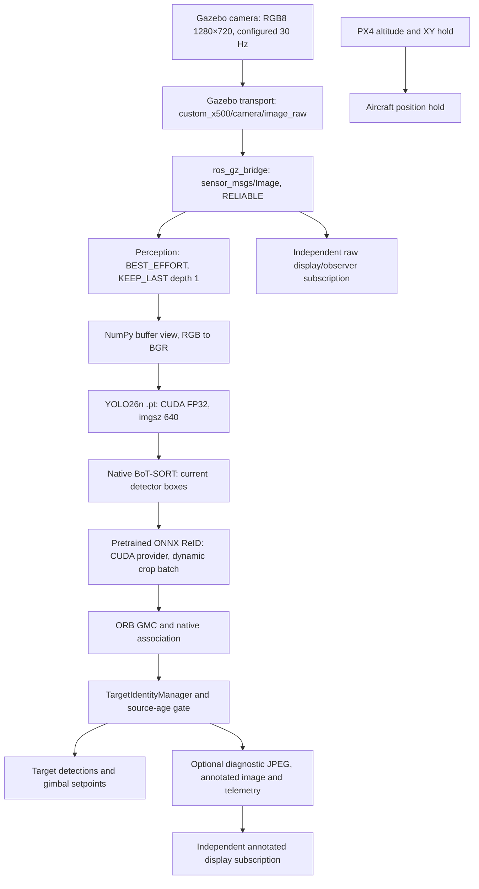

# Perception and video pipeline audit — 2026-10-15

**IN PROGRESS — results and acceptance are not final yet.** This task concerns transport/runtime performance. Target identity continuity remains FAIL independently of performance. No UAV body-following exists.

## Scope and provenance

Ponytail 5.2.0 was installed using the official `DietrichGebert/ponytail` marketplace and plugin commands. The standalone official skill was installed with the supplied skill installer, pinned to commit `84740e3d344b69b4a133201fa519eb37a62a2b2a`; its Git blob is `b76922f76ec6f4db532203c55d710b749fa1f6af`. The CLI `/hooks` screen confirmed trust and active lifecycle hooks. An existing Node installation was exposed on the existing user PATH; no Node package was installed. This running desktop conversation uses the read upstream skill directly; desktop hook reload after app restart was not tested.

Evidence is in `evaluation/results/runs/perception_video_audit_20261015T080217Z/`. The before manifest freezes the existing dirty workspace. Prior investigations are retained separately; they are not substituted for a paired performance baseline. The retained 1 ms executor yield belongs to the baseline. Model weights, precision, thresholds, tracker algorithm, guard policy, controller and scenarios are fixed.

## Actual data path

The current perception output reaches the gimbal only. PX4 body control is an independent position/altitude hold loop, not a consumer of target detections. There is no perception-to-PX4 body-following path to benchmark. In the test runner autonomous gimbal tracking is disabled to preserve its prescribed camera-yaw scenarios; unit/ROS integration tests cover the command path.

YOLO, BoT-SORT, ReID, the guard, publishing and annotation run synchronously in one image callback. Images, reset and watchdog/statistics share a mutually exclusive callback group; `/clock` uses the default group. A two-worker executor dispatches with the existing 1 ms yield. A Python processing worker does not hold an application FIFO of camera frames. The DDS image history is bounded to one unread sample. The existing `is_processing` drop counter is generally zero because callback serialization prevents reentry; it is not a count of source frames skipped by DDS.

Source time comes from Gazebo `/world/<world>/clock`, bridged to ROS `/clock`; image headers use that simulation epoch. Age is checked at ingress and after detector/tracker processing with the existing 0.75 s budget. Expired outputs do not enroll, teach identity or command a target. Durations use monotonic wall time. Wall/RMW timestamps and simulation timestamps are recorded separately and are never directly subtracted.

## Copies and runtime details

- No `cv_bridge` occurs in this node. `image_to_bgr` views the ROS byte buffer with NumPy, honors `step`, then converts RGB8 to BGR. The BGR input branch currently makes its own copy. Mono inputs convert to BGR.
- Native Ultralytics letterboxes the 720×1280 camera image to 384×640 for `imgsz=640` with rectangular padding. The installed predictor already avoids `np.stack` for one image. It transfers uint8 input to CUDA, permutes/flips channels on device, creates contiguous NCHW storage, converts to FP32 and normalizes. No duplicate preprocessing is added by this task.
- Detector boxes cross to CPU/NumPy for the native tracker. These small measurements must remain available to BoT-SORT and the guard. Auxiliary HSV descriptors are computed from current CPU torso crops.
- Native BoT-SORT initializes high/low-confidence detection groups, calls the configured encoder for nonempty groups, applies ORB GMC and runs association. ReID can therefore have multiple calls per frame; timing and crop counts are accumulated per update. The pretrained ONNX model has dynamic batch/height/width and 512-dimensional outputs. The native encoder batches valid crops within each group; it does not make a separate inference for every person.
- The native encoder resizes/normalizes crops on CPU and moves the batch to CUDA. The installed dynamic ONNX backend then calls `im.cpu().numpy()` before `session.run`; it returns CPU arrays which `AutoBackend` moves to CUDA before the encoder copies embeddings back to CPU. These repeated transfers are an identified candidate, not a claim that a replacement is accepted.
- ORB operates on its native downscaled grayscale frame and excludes detection boxes for estimation. Its algorithm and determinant validation remain fixed. Adapter residual time is reported separately from nested ReID/GMC; nested durations must not be added twice.
- Target output is published before diagnostic JPEG creation and annotation. Those display/evaluation operations still occupy the image callback and can reduce processing throughput. Annotated output remains RELIABLE, KEEP_LAST depth 10. Source header stamps are preserved.
- The current runtime uses raw `sensor_msgs/Image`. No RTSP/GStreamer input, `CompressedImage`, image-transport compression or dashboard-to-AI decode path exists in the production source. OpenCV video capture/writing appears in offline evaluation, not as the live AI source. Compression, composition and a new video server are not justified by this local raw-image audit.

## Measurement definitions

`/yolo/performance` is opt-in and off by default. It records source stamp, callback receipt (wall/monotonic/source clock), RMW publish/receive wall stamps, processing start, YOLO completion and native preprocess/inference/postprocess durations, ReID completion/crop/preprocess/backend timings, GMC completion, tracker completion, guard decision, output publish and completion of the whole callback. Existing five-value `/yolo/telemetry` is unchanged.

`profile_perception_pipeline.py` observes native Gazebo source frames independently, raw ROS delivery, the node's own callback/completion events, annotated delivery, resources and optionally actual Qt paint events. A source stamp is counted as painted only when a new image is drawn; delivery counts are not called rendered FPS. This is an instrumented Qt viewer using installed Qt, not a measurement of rqt/RViz compositor presentation. No claim about Windows physical display refresh is made.

The controlled ROS test uses the same saved raw camera image (frame 400, three people), RGB8 at 30 Hz, separate 250 Hz `/clock` publication and the actual production node in ROS domain 84. Source capture wall/monotonic stamps are joined by exact source key, so capture-to-DDS and capture-to-output wall ages can be measured without converting simulation time. It isolates transport/inference choices; complete Gazebo traces check behavior when faster processing changes the selected input sequence.

The first live probe had no Gazebo publisher and is excluded. One subsequent startup was excluded because old SITL processes still held the port; it did not produce valid runtime evidence. The first complete baseline's RMW metadata fields were zero because the instrumentation incorrectly treated rclpy's dictionary as an object. Its source-clock ages and other durations are valid; its middleware/queue latency is unavailable. The dictionary access was corrected and a regression was added. Missing timestamps are never treated as zero latency.

## Preliminary complete Gazebo observations

The eager/default-transport baseline (`tracking_3_people_20261015T081427Z`) completes and lands. Its profiler starts late, at source 77.848 s; do not compare its full window directly with a candidate beginning in warmup. The eager/large-buffer transport run (`tracking_3_people_20261015T081935Z`) also completes and lands. The primary causal before/after comparison will use matched controlled inputs; complete-run comparisons will state common source-time coverage and capture limitations.

| Complete run, observed wall rates | Default transport | Large transport |
|---|---:|---:|
| Native Gazebo source FPS | 29.07 | 28.85 |
| Independent raw ROS delivery FPS | 9.40 | 28.60 |
| Actual AI processing FPS | 5.57 | 6.24 |
| Annotated delivery FPS, no GUI | 2.58 | 6.23 |
| Unique frames painted (display off) | 0 | 0 |
| Decision age p95, source ms | 360 | 296 |

These complete-run windows differ and are preliminary observations, not an isolated causal FPS estimate. Faster raw transport alone does not remove inference/ReID time. A late ReID stall in the transport run exceeds the age budget and is rejected; this is processing delay, not evidence of an unbounded camera backlog.

## Final benchmark and review

Pending controlled comparisons, display on/off, final runtime/replay and regression review. No final performance verdict is claimed yet.
